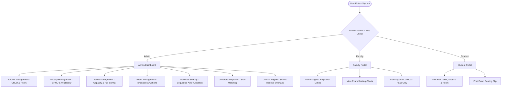
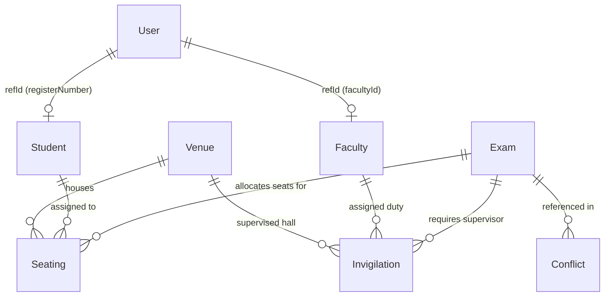

# Examination Seating and Invigilation Management System

> **A 3rd-Year B.E. Computer Science & Engineering Full-Stack Web Application (MERN Stack)**
> Built to automate examination seating arrangements, faculty invigilation assignments, and detect timetable, venue capacity, and staff conflicts in real-time.

---

## 📖 Project Overview

Managing semester examination logistics in educational institutions often suffers from human scheduling errors, double-booked examination halls, faculty timetable clashes, and manual seating distribution overhead.

This project delivers an automated, explainable, and conflict-free **Examination Seating and Invigilation Management System** developed using the **MERN (MongoDB, Express.js, React.js, Node.js) Stack**.

### Key Highlights
* 🎓 **Role-Based Access Control (RBAC):** Distinct dashboards and permissions for **Admin / Exam Coordinator**, **Faculty / Invigilator**, and **Student**.
* 🪑 **Automated Seating Generation:** Sequential allocation ($S_1, S_2, S_3, \dots$) matching target cohorts (Department, Year, Section) to active examination halls with strict capacity validation.
* 👨‍🏫 **Automated Invigilation Assignment:** Assigns available faculty to active exam halls while preventing faculty timetable clashes across overlapping exams.
* 🛡️ **Comprehensive Conflict Engine:** Scans and reports 11 distinct real-world timetable, room capacity, and resource conflicts with human-readable explanations and suggested resolutions.
* 🔒 **Data Safety & Integrity:** Dependency-safe deletions prevent orphaned foreign references and accidental data loss.
* 🎨 **Clean Light Purple Theme:** Built with student-project appropriate aesthetics, clear tables, status pills, and interactive modals.

---

## 🛠️ Technology Stack

| Layer | Technology | Purpose |
| :--- | :--- | :--- |
| **Frontend** | React.js 18 + Vite | Single-Page Application (SPA) with component-driven architecture |
| **Routing** | React Router DOM v6 | Client-side declarative routing and protected route guards |
| **Styling** | Custom CSS3 | Light Purple theme (`#7c3aed`, `#ede9fe`, `#f8fafc`) with responsive layout |
| **Icons** | Lucide React | Clean, lightweight UI icons |
| **Backend** | Node.js + Express.js | RESTful API server with modular controllers, routes, and middleware |
| **Database** | MongoDB Atlas / Local | Document-based NoSQL database with Mongoose schema modeling |
| **Authentication** | JWT + bcryptjs | Secure password hashing (10 salt rounds) & stateless token sessions |

---

## 👥 User Roles & Permissions



### 1. Admin / Exam Coordinator
* **Full CRUD Operations:** Add, edit, delete, search, and filter students, faculty, venues, and examinations.
* **Seating Generation:** Automatically allocates students across active rooms with sequential seat numbering ($S_1, S_2, \dots$).
* **Invigilation Generation:** Assigns 1 faculty member per examination hall and checks for overlapping duty clashes.
* **Conflict Resolution:** Runs live conflict scans across the database and marks issues as resolved.
* **Safe Operations:** Protected from deleting venues, faculty, or students that are actively referenced in live seating records.

### 2. Faculty / Invigilator
* **Duty Schedule:** View assigned examination duties, hall numbers, dates, and time slots.
* **Hall Plans:** Inspect student seating distribution for invigilated halls.
* **Restricted Access:** Cannot create, edit, or delete administrative examination records.

### 3. Student
* **Personal Hall Ticket:** View assigned examination date, time slot, venue name, room number, allocated seat number, and invigilator name.
* **Print Ready:** 1-Click printing for examination seat confirmation slips.
* **Restricted Access:** Read-only access to their own cohort and seating records.

---

## 📊 Database Schema & Relationships

The system uses 7 Mongoose models with ObjectId references:



1. **User:** `username`, `password` (hashed), `role` (`admin` | `faculty` | `student`), `name`, `refId`, `email`
2. **Student:** `name`, `registerNumber` (unique), `department`, `year`, `section`, `email`
3. **Faculty:** `name`, `facultyId` (unique), `department`, `availability` (boolean), `email`, `phone`
4. **Venue:** `venueName`, `roomNumber` (unique), `capacity` (> 0), `floor`, `availability` (boolean)
5. **Exam:** `subject`, `subjectCode`, `examDate`, `startTime`, `endTime`, `department`, `year`, `section`, `status`
6. **Seating:** `examId` (ref), `studentId` (ref), `registerNumber`, `studentName`, `venueId` (ref), `roomNumber`, `seatNumber`
7. **Invigilation:** `examId` (ref), `venueId` (ref), `facultyId` (ref), `facultyCode`, `facultyName`, `roomNumber`, `examDate`, `startTime`, `endTime`
8. **Conflict:** `conflictType`, `title`, `description`, `severity`, `details`, `suggestedSolution`, `status`

---

## ⚡ Conflict Detection Engine

The system scans the following 11 realistic examination constraints:

| Conflict Code | Condition Detected | Recommended Solution |
| :--- | :--- | :--- |
| `FACULTY_TIMETABLE` | Same faculty assigned to multiple overlapping exam duties. | Reassign duty to another available faculty member. |
| `VENUE_TIMETABLE` | Same hall allocated to multiple exams at the same time. | Allocate a different venue or adjust exam timings. |
| `EXAM_TIMETABLE` | Same student group scheduled for 2 overlapping exams. | Reschedule one exam to another date or time slot. |
| `MISSING_INVIGILATION` | Seating generated for hall but no invigilator assigned. | Click "Generate Invigilation" or assign faculty. |
| `INSUFFICIENT_FACULTY` | Allocated halls exceed total available faculty members. | Add more faculty or mark unavailable faculty as active. |
| `INSUFFICIENT_CAPACITY` | Enrolled students exceed total active hall capacity. | Add halls or activate maintenance venues. |
| `UNAVAILABLE_FACULTY` | Faculty marked "Unavailable" but assigned to active duty. | Reassign duty or toggle faculty availability. |
| `UNAVAILABLE_VENUE` | Hall marked "Inactive" but has student seats allocated. | Regenerate seating or mark venue active. |
| `MISSING_STUDENTS` | Exam scheduled but zero matching students exist. | Register students for target department/year/section. |
| `INVALID_EXAM_TIMING` | Exam End Time $\le$ Start Time. | Update schedule with end time after start time. |
| `DUPLICATE_SEATING` | Student receiving multiple seats for same exam. | Prevented via compound unique indexes & safe regeneration. |

---

## 🚀 Step-by-Step Installation & Setup

### Prerequisites
* **Node.js** (v18 or higher recommended)
* **npm** (v9 or higher)
* **MongoDB** (Local Community Server running on `mongodb://127.0.0.1:27017` OR MongoDB Atlas connection URI)

---

### Step 1: Clone or Navigate to Project Directory
```bash
cd "c:\Users\PRASANTH E\OneDrive\Desktop\Projects\Examination-Seating-Invigilation-System-Ai"
```

---

### Step 2: Configure Backend Environment Variables
Create or verify `backend/.env`:
```env
PORT=5000
MONGODB_URI=mongodb://127.0.0.1:27017/exam_seating_db
JWT_SECRET=examination_seating_jwt_secret_key_2026_cse
NODE_ENV=development
```
*(For MongoDB Atlas, simply replace `MONGODB_URI` with your connection string: `mongodb+srv://<user>:<password>@cluster0.xxxxx.mongodb.net/exam_seating_db?retryWrites=true&w=majority`)*

---

### Step 3: Install Dependencies
```bash
# Install backend packages
cd backend
npm install

# Install frontend packages
cd ../frontend
npm install

# Return to root directory
cd ..
```

---

### Step 4: Seed Database with Working Demo Data
```bash
cd backend
npm run seed
```
This populates:
* **1 Admin** user
* **6 Faculty** members with logins (`FAC101` to `FAC106`)
* **4 Examination Venues** (`LH-101`, `LH-102`, `SH-201`, `SB-301`)
* **30 CSE 3rd Year Section A Students** with accounts (`7376221CS101` to `7376221CS130`)
* **3 Scheduled Examinations** (`CS3501 Compiler Design`, `CS3502 DBMS`, `CS3503 Computer Networks`)

---

### Step 5: Start Backend and Frontend Servers

**Terminal 1 — Backend API Server:**
```bash
cd backend
npm start
```
*Backend runs on: `http://localhost:5000`*

**Terminal 2 — Frontend Application:**
```bash
cd frontend
npm run dev
```
*Frontend runs on: `http://localhost:3000`*

---

## 🔑 Demo Login Credentials

The application provides **1-Click Demo Login buttons** on the login page:

| Role | Username | Password | Purpose |
| :--- | :--- | :--- | :--- |
| **Admin** | `admin` | `admin123` | Full control over students, faculty, venues, exams, seating, invigilation, conflicts |
| **Faculty** | `fac101` | `faculty123` | View assigned exam duties (Dr. Rajesh Kumar) |
| **Faculty** | `fac102` | `faculty123` | View assigned exam duties (Dr. Priya Sharma) |
| **Student** | `7376221cs101` | `student123` | View seat number and allocated examination hall (Aarav Patel) |
| **Student** | `7376221cs102` | `student123` | View seat number and allocated examination hall (Aditi Sharma) |

---

## 🎓 College Viva & Oral Examination Guide

### Q1: Why did you choose the MERN stack for this project?
* **MongoDB:** Flexible document model with dynamic schemas for nested hall allocations and conflict details.
* **Express.js & Node.js:** Lightweight, event-driven REST API runtime allowing rapid I/O operations and straightforward middleware integration.
* **React.js:** Fast virtual DOM updates, component reusability, declarative routing with React Router, and clean state synchronization.

### Q2: How does the Seating Generation Algorithm work?
1. Fetches students filtered strictly by the examination's Department, Year, and Section.
2. Queries active venues (`availability: true`) sorted by room capacity.
3. Computes the cumulative capacity: if $\sum \text{Capacity} < \text{Total Students}$, it rejects the generation with an exact discrepancy message rather than creating incomplete/partial seating.
4. If capacity is sufficient, it iterates through the venues and assigns seats sequentially ($S_1, S_2, \dots, S_n$) per hall.
5. Safely deletes any prior seating allocations for this specific exam to guarantee zero duplicate records on regeneration.

### Q3: How does the Invigilation Duty Assignment Algorithm work?
1. Gathers all distinct venue halls utilized in the exam's seating arrangement.
2. Checks total active faculty members (`availability: true`).
3. Queries existing invigilation records to detect any timetable clashes during the same date and overlapping time window ($\max(\text{start}_1, \text{start}_2) < \min(\text{end}_1, \text{end}_2)$).
4. Assigns 1 conflict-free faculty member per active hall and records the duty in MongoDB.

### Q4: How is Role-Based Authorization enforced?
* Passwords are encrypted with **bcrypt** (10 salt rounds).
* Upon login, the backend issues a signed **JSON Web Token (JWT)** containing the user's ID.
* The `authMiddleware.js` verifies the token on incoming requests and the `authorize('admin')` middleware blocks unauthorized users at the API level with HTTP 403 Forbidden responses.
* The frontend `ProtectedRoute.jsx` checks the user's role and prevents client-side navigation to unauthorized routes.

---

## 📁 Project Directory Structure

```text
Examination-Seating-Invigilation-System-Ai/
├── backend/
│   ├── config/
│   │   └── db.js                 # MongoDB connection logic
│   ├── models/
│   │   ├── User.js               # Auth & role model (bcrypt)
│   │   ├── Student.js            # Student records model
│   │   ├── Faculty.js            # Faculty records model
│   │   ├── Venue.js              # Examination hall model
│   │   ├── Exam.js               # Exam schedule model
│   │   ├── Seating.js            # Seat allocations model
│   │   ├── Invigilation.js        # Invigilator duties model
│   │   └── Conflict.js           # Detected conflicts model
│   ├── middleware/
│   │   ├── authMiddleware.js     # JWT & role authorization
│   │   └── errorMiddleware.js    # Centralized error handler
│   ├── utils/
│   │   └── conflictDetector.js   # 11-rule conflict scan engine
│   ├── routes/
│   │   ├── authRoutes.js         # /api/auth
│   │   ├── studentRoutes.js      # /api/students
│   │   ├── facultyRoutes.js      # /api/faculty
│   │   ├── venueRoutes.js        # /api/venues
│   │   ├── examRoutes.js         # /api/exams
│   │   ├── seatingRoutes.js      # /api/seating
│   │   ├── invigilationRoutes.js # /api/invigilation
│   │   ├── conflictRoutes.js     # /api/conflicts
│   │   └── dashboardRoutes.js    # /api/dashboard
│   ├── server.js                 # Express application entry
│   ├── seed.js                   # Realistic database seeder
│   ├── test_api.js               # Automated 24-test suite
│   ├── .env                      # Environment configuration
│   └── package.json
│
├── frontend/
│   ├── src/
│   │   ├── components/
│   │   │   ├── Navbar.jsx        # Top header & user badge
│   │   │   ├── Sidebar.jsx       # Dynamic role-based sidebar
│   │   │   ├── Layout.jsx        # Master layout wrapper
│   │   │   ├── Toast.jsx         # Floating toast alerts
│   │   │   ├── Modal.jsx         # Generic animated modal
│   │   │   ├── StatCard.jsx      # Metric stat cards
│   │   │   └── ProtectedRoute.jsx# Auth & role route guards
│   │   ├── context/
│   │   │   ├── AuthContext.jsx   # User session provider
│   │   │   └── ToastContext.jsx  # Notification provider
│   │   ├── services/
│   │   │   └── api.js            # Centralized API client
│   │   ├── pages/
│   │   │   ├── Login.jsx         # Login with 1-click demo
│   │   │   ├── Dashboard.jsx     # Metrics & recent exams
│   │   │   ├── StudentsPage.jsx  # Student CRUD & filters
│   │   │   ├── FacultyPage.jsx   # Faculty CRUD & availability
│   │   │   ├── VenuesPage.jsx    # Venue CRUD & capacity
│   │   │   ├── ExamsPage.jsx     # Exam schedule & timings
│   │   │   ├── SeatingPage.jsx   # Seating generator & visualizer
│   │   │   ├── InvigilationPage.jsx # Duty generator & reassign
│   │   │   ├── ConflictsPage.jsx # Conflict scan & resolution
│   │   │   ├── FacultyDutiesPage.jsx # Faculty portal
│   │   │   └── StudentMySeatPage.jsx # Student portal
│   │   ├── styles/
│   │   │   └── index.css         # Light purple stylesheet
│   │   ├── App.jsx               # Routes setup
│   │   └── main.jsx              # React DOM entry
│   ├── index.html
│   ├── vite.config.js
│   └── package.json
│
├── .gitignore
├── package.json
└── README.md
```

---

## 🧪 Automated Verification & Testing

To run the comprehensive backend test suite that checks all 24 core operations against the database:

```bash
cd backend
npm test
```

### Verified Test Cases:
* [x] **Test 1:** Admin authentication, bcrypt password hashing, and JWT token generation.
* [x] **Test 2 & 3:** Student creation, required field validation, and duplicate register number rejection (HTTP 409).
* [x] **Test 4:** Student update and safe deletion.
* [x] **Test 5 & 6:** Venue capacity validation ($\text{Capacity} > 0$) and duplicate room rejection.
* [x] **Test 7:** Exam scheduling with start/end time validation ($\text{End Time} > \text{Start Time}$).
* [x] **Test 8 & 9:** Seating generation, student-to-venue matching, sequential seat numbers ($S_1, S_2, \dots$).
* [x] **Test 10 & 11:** Invigilation generation, 1 faculty per hall, and timetable clash avoidance.
* [x] **Test 12 – 16:** Conflict detection engine scanning faculty overlap, venue overlap, and missing invigilation.
* [x] **Test 17 & 18:** Faculty role duties retrieval and permission restrictions.
* [x] **Test 19 & 20:** Student role hall ticket and seat lookup.
* [x] **Test 21 & 22:** Dependency-safe deletion preventing removal of venues/faculty in active use.
* [x] **Test 23 & 24:** Regeneration safety ensuring previous records are cleanly replaced without duplicates.

---

## 👨‍💻 Author

**3rd-Year B.E. Computer Science & Engineering Student**  
*Full Stack Web Development Project*


